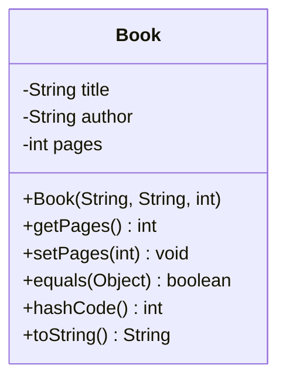
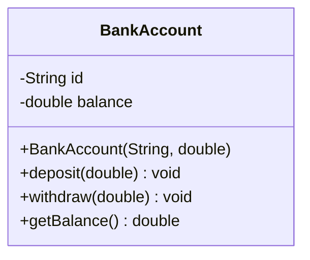
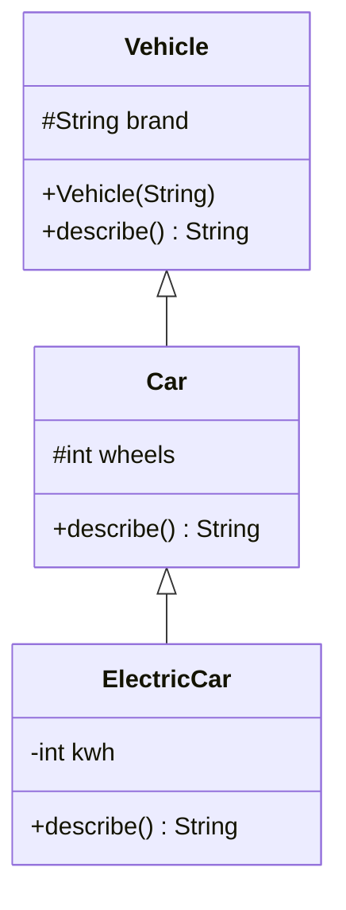
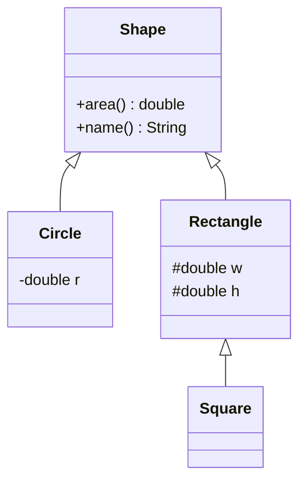
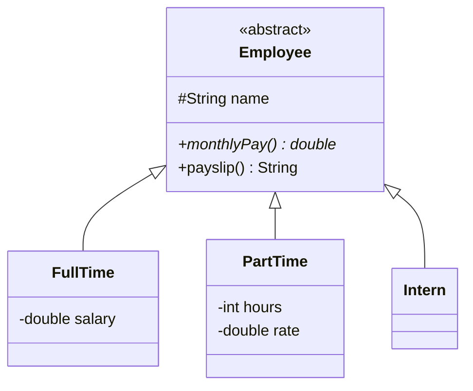
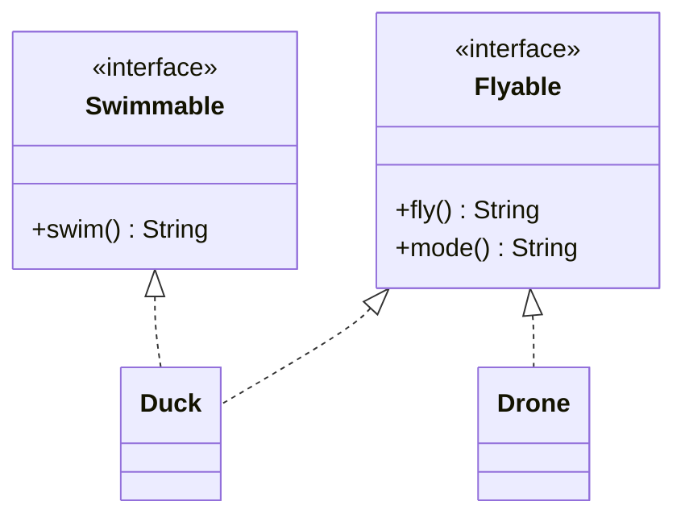
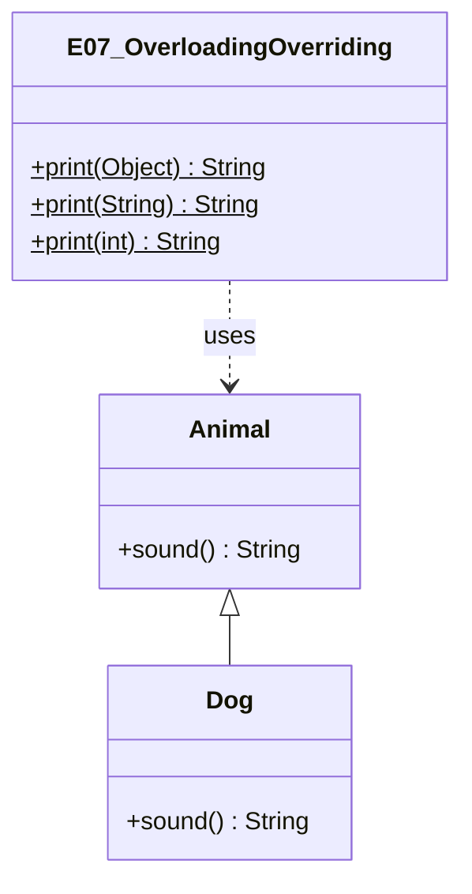
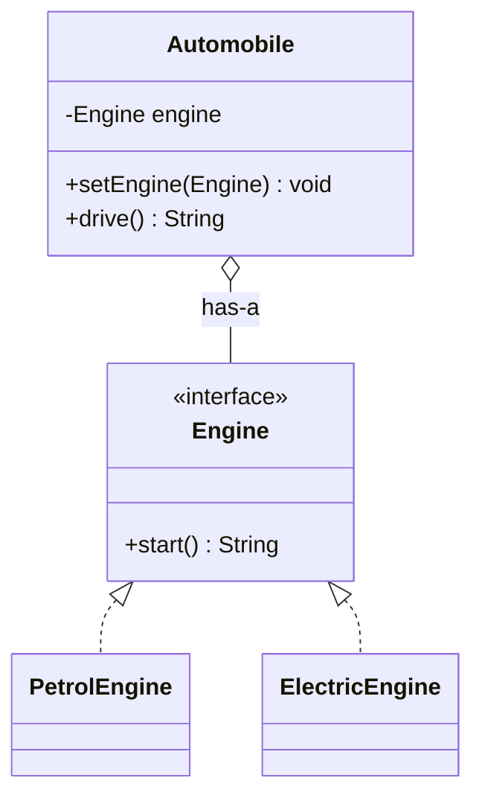
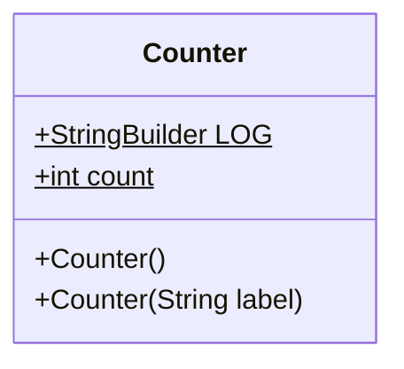
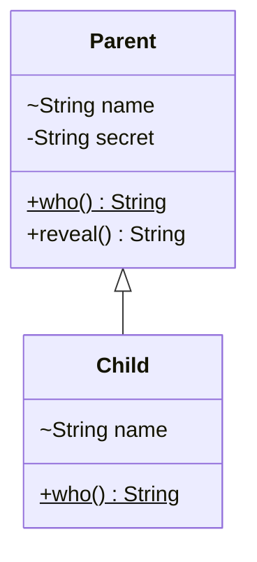

# UML Class Diagrams for the 10 Java Examples

Written in Mermaid `classDiagram` syntax (renders natively on GitHub, VS Code with the Markdown Preview Mermaid extension, and mermaid.live).
Notation: `-` private, `+` public, `#` protected, `<|--` inheritance, `<|..` implements, `*--` composition, `o--` aggregation, `..>` dependency.

## E01 - Classes and Objects

## E02 - Encapsulation

## E03 - Inheritance

## E04 - Polymorphism

## E05 - Abstraction

## E06 - Interfaces

## E07 - Overloading vs Overriding

## E08 - Composition

## E09 - Static and Constructors

## E10 - Misconceptions (hiding)

